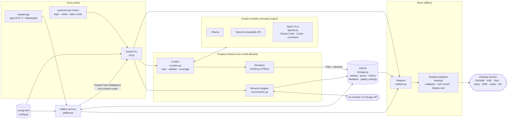

# Artwall

A local museum curator for Linux desktops. It discovers public-domain works from the Art Institute of Chicago, asks a **vision model** (local by default, through Ollama or any OpenAI-compatible API) to select and compose them, renders wallpapers at your display's resolution with small editorial captions, and keeps a ready-to-show offline queue. One artwork per wallpaper is the default.

Artwork is never generated or recolored. The museum supplies titles, artists, dates, rights, and source pages. The model chooses the work, layout, and short source-grounded caption. Rendering is deterministic. A narrow work remains intact against a softly blurred, subdued backdrop drawn from its colors. A fine border and soft shadow distinguish the sharp original from its surround, with the caption in the exposed space when it fits.

## First wallpaper

Artwall supports GNOME, KDE Plasma, Xfce, Cinnamon, MATE, Sway, Niri, Hyprland, and X11 window managers. `artwall init` detects your display size, and the default `auto` backend picks the right wallpaper and lock-screen setter for the running session (see [Desktop support](#desktop-support)).

```bash
bash scripts/install
artwall init
artwall refresh
artwall curate --count 3
artwall next
```

`scripts/install` creates a virtual environment that can see your distribution's PyGObject, GTK 4, and libadwaita (PyGObject does not build cleanly from PyPI), links `~/.local/bin/artwall`, and adds **Artwall** to your app launcher. Install those system packages first for the app: Fedora `python3-gobject gtk4 libadwaita`, Debian/Ubuntu `python3-gi gir1.2-gtk-4.0 gir1.2-adw-1`, Arch `python-gobject gtk4 libadwaita`. The command-line tools and timers work without them.

`artwall next --no-apply` updates the local current composition without contacting the graphical session; it is useful from a terminal outside the graphical session. The canonical current files are `~/.cache/artwall/current.png` and `current.json` (unless XDG paths are customized). Source originals and queued PNGs live under `~/.local/share/artwall/`.

The default local curator is the `qwen3.6:27b` vision model through Ollama (`ollama pull qwen3.6:27b`, or set `[llm].model` to another vision model you have installed). Keep the Ollama daemon running when preparing new compositions. A failed or unavailable model falls back to deterministic, metadata-based curation. Rotation itself never calls Ollama or a museum API. To prepare a queue entirely without the model:

```bash
artwall curate --offline --count 5
```

The Art Institute asks clients to download one image at a time with about a second between requests. An initial refresh and cache fill can take a few minutes. Later runs reuse SQLite API responses and image files. Cached and downloaded JPEGs must fully decode before curation. A damaged cache file is downloaded again; if its replacement fails, that candidate is skipped so other works can still be prepared. A work the museum serves only below 1400 pixels is remembered and not downloaded again. Curation runs started together (a timer, the command line, and the app) re-check the queue before rendering, so no work is queued twice. Scheduled refreshes advance through results pages, so the local catalog continues to expand; `artwall refresh --page N` targets a page explicitly.

## Everyday commands

```text
artwall next                    Next cached composition
artwall gui                     Open the Artwall app
artwall install-launcher        Add the app to your app launcher
artwall previous                Return to an earlier composition
artwall like | dislike          Teach taste; dislike also shows the next work
artwall favorite | skip         Save or move on
artwall more-from-artist        Increase the current artist's score
artwall less-from-artist        Decrease it
artwall blacklist-current       Exclude the primary work
artwall blacklist-artist        Exclude the primary artist
artwall info                    All works, caption, relationship, museum links
artwall open                    Open the primary museum page
artwall history | favorites     Inspect local records
artwall status                  Queue and current image
artwall debug-current           Raw museum metadata and curator decision
artwall render --output FILE    Re-render the current decision
artwall refresh                 Update museum metadata
artwall curate --count 14       Prepare future wallpapers
artwall curate --count 3 --next Prepare wallpapers to show ahead of the old queue
```

The commands are intentionally small so they can be bound to keyboard shortcuts in your desktop's settings or your compositor's config (for example a Niri `spawn`, Hyprland `bind = ..., exec, artwall next`, or Sway `bindsym ... exec artwall next`).

## The Artwall app

Open **Artwall** from your app launcher, or run `artwall gui`. It is a native GTK 4 and libadwaita app with three pages: **On Your Wall** (the current composition, its description, works, and museum links), **Coming Next** (the prepared queue, and **Prepare New Wallpapers**), and **Recently Seen**. Select any card for its details. You can like, dislike, favorite, or comment on a composition; exclude artists and works; and, under Preferences (Ctrl+,), set the rotation interval, curator model, and how many works share a wallpaper. Alt+1–3 switch pages; F5 refreshes. Opening it again brings the existing window forward.

**Prepare new wallpapers**, beside **Coming next**, prepares up to three wallpapers in the background using saved settings and feedback. Progress and failures appear beside the button. New results go to the front of the queue; the current wallpaper, older queued work, history, and favorites are preserved. Use it after saving layout settings or feedback to see their effect without waiting through an older batch. The command-line equivalent is `artwall curate --count 3 --next`; ordinary scheduled curation continues to append to the queue.

**Feedback for the Curator** appears below the current wallpaper and in each composition's details. Describe spacing, pairings, captions, or what you like about the work. Notes are saved locally, can be edited or cleared, and the eight most recently edited notes are supplied to the local model with their artwork and layout context during future curation (up to 800 characters per note and about 4,000 characters in total, newest first). Feedback guides preferences; it cannot override museum facts or validation. It does not re-render existing wallpapers, and offline curation does not interpret written feedback.

Thumbs down on the current work immediately shows the next eligible cached composition. Thumbs down on an upcoming work removes it from rotation. The disliked work stays out of future curation until that feedback is reversed. If no alternative is cached, the dislike is saved and the app says why the wallpaper stayed put. A favorite includes a like; removing the favorite removes that like as well. Artist blacklists match names regardless of capitalization.

Lowering the artwork limit filters previously queued compositions that exceed it immediately. Raising the limit allows more works in newly prepared layouts; it does not rearrange already rendered wallpapers. Save the setting, then choose **Prepare new wallpapers** to put fresh layouts next in rotation. Previously viewed compositions remain in history.

The interval, model, and artwork limit you save in the app are stored in the database and take precedence over the same keys in `config.toml`, which artwall never rewrites. `artwall status` lists any saved values.

With **Up to two** or **Up to three**, a work that already fits the display stays alone. A narrow selection is compared with related pairs and, when allowed, trios at the actual display proportions. The coverage check prefers balanced groups with compatible colors and tonal contrast. Whole works share aligned edges, a common height, and a small consistent gap. If a suitable grouping is unavailable, the intact original keeps its diffuse surround; an enlarged detail is only used when explicitly chosen by the curator. Existing cached PNGs retain their prepared layouts; `artwall curate` prepares wallpapers with the current layout rules, while `artwall render --output FILE` previews the current decision with the updated renderer.

Wallpaper captions wrap titles, metadata, companion labels, and the prepared description without cutting them off at a fixed number of lines. Line spacing follows the measured font size. If a complete caption is too tall, the renderer tries a wider column and then smaller type, keeping the text and its shadow inside the display margins. Full museum titles and catalog details remain available in the gallery and `artwall info`.

## Scheduling

After the first wallpaper works in your desktop session:

```bash
artwall install-timers
```

This writes five `systemd --user` units under `~/.config/systemd/user/` and enables a login service plus the rotation and daily curation timers. The login service advances one cached wallpaper when the time since the last successful wallpaper change exceeds the configured interval. Rotation then shows another every two hours by default. Daily curation refreshes ArtIC metadata and renders the next queue. The app updates an installed rotation timer when you change the interval there. If you edit `[rotation].interval_minutes` in `config.toml` instead, run `artwall install-timers` again (a value saved in the app still wins). `artwall install-timers --no-enable` writes the units without enabling them.

The rotation timer starts with the graphical session and does not catch up missed intervals while the computer is off. At login, Artwall keeps the current wallpaper if it changed within the interval; after a longer gap it advances once. Each later timer run also advances once. A failed desktop update leaves that work queued for the next attempt. The login service retries briefly if the wallpaper backend is still starting. Run `artwall next --if-due` to apply the same check manually.

The timers rely on your session starting `graphical-session.target` and exporting `WAYLAND_DISPLAY` or `DISPLAY` to the systemd user manager. GNOME, Plasma, and sessions launched through uwsm do this. For a compositor or window manager started another way, add `systemctl --user import-environment WAYLAND_DISPLAY DISPLAY && systemctl --user start graphical-session.target` to its autostart, or run `artwall next --if-due` from autostart and `artwall next` from cron.

## Configuration

`artwall init` writes `~/.config/artwall/config.toml` from [config.example.toml](artwall/config.example.toml). `init` fills `[display]` with the detected size of the focused or primary monitor (or `[wallpaper].output`); if detection fails it uses 1920 × 1080 and you should edit it. One size is rendered for all monitors; desktops scale it to other displays. Values must use their TOML types (for example `true`, not `"true"`); a mistyped value is refused rather than guessed. Notable options:

- `[wallpaper].backend` and `output`: see [Desktop support](#desktop-support).
- `[lockscreen].backend`: `auto`, `dms`, `hyprlock`, `swaylock`, `kde`, or `none`.
- `[lockscreen].public_lock_screen_safe`: conservative metadata keyword filtering when `true`. This is a best-effort filter, not image classification.
- `[llm].provider`, `model`, and `base_url`: `ollama` (default) or `openai` for any OpenAI-compatible `/chat/completions` API: llama.cpp, vLLM, LM Studio, OpenRouter, or OpenAI itself. For `openai`, `base_url` includes `/v1`. A key, when the server needs one, comes from the environment variable named by `api_key_env` (default `OPENAI_API_KEY`) or from `api_key_file`; it is never written to config.toml. The timers do not see your shell's environment, so prefer `api_key_file` (mode 600) for scheduled curation. A hosted API receives the contact sheet of public-domain thumbnails, museum metadata, and your written feedback; rotation still never calls it. The model must accept images.
- `provider = "agent"` curates through a signed-in agent CLI, using its subscription instead of an API key: `agent = "claude"` (Claude Code) or `"codex"` (Codex CLI). Leave `model = ""` for the agent's default, or name one of its models. Each request runs the agent once in an empty temporary directory with nothing it can change: Claude Code with no tools, MCP servers, or user settings, and no saved session; Codex in its read-only sandbox, ephemeral. `agent = "command"` runs any other CLI from `agent_command`, a list of arguments where `{image}` is replaced by the contact sheet's path; the prompt arrives on stdin and the answer is read from stdout. The daily curation timer runs the same way, and artwall looks for agents and their runtimes (such as `node`) in common install locations, because timers start with a minimal `PATH`. Agents add a large built-in prompt to every request (about 13,000 tokens for Codex in testing), and each prepared wallpaper takes two or three requests, so consider a smaller `[curation].batch_size` if you are close to your plan's limits.
- `[curation].max_artworks`: `1` by default; raise to `2` or `3` to allow paired works again.
- `[curation].explore_fraction` and `wildcard_fraction`: retain discovery alongside learned favorites.

## Desktop support

With `backend = "auto"`, artwall uses the running desktop's own setter when `XDG_CURRENT_DESKTOP` names one, otherwise the first installed standalone tool.

| Backend | Desktop | Command used | `output` |
| --- | --- | --- | --- |
| `gnome` | GNOME, Budgie, Unity | `gsettings` (light and dark picture) | ignored |
| `kde` | KDE Plasma 5.24+ | `plasma-apply-wallpaperimage` | ignored |
| `xfce` | Xfce | `xfconf-query` on each existing backdrop | monitor name |
| `cinnamon` | Cinnamon | `gsettings` | ignored |
| `mate` | MATE | `gsettings` | ignored |
| `sway` | Sway | `swaymsg output … bg` | output name |
| `dms` | DankMaterialShell (Niri, Hyprland, …) | `dms ipc` | output name |
| `awww`, `swww` | Any wlroots compositor, Niri, Hyprland | `awww img` / `swww img` (daemon must be running) | output name |
| `feh` | X11 window managers (i3, bspwm, Openbox, …) | `feh --bg-fill`; restore at login with `~/.fehbg` | ignored |

Auto order outside those desktops is `dms`, `awww`, `swww`, then `feh` in an X11 session. `artwall status` shows which backend `auto` resolves to. Every backend receives the immutable composition path, so desktops that cache by filename notice each rotation.

Lock screens: GNOME and Cinnamon lock screens already follow the wallpaper, so they need nothing. `auto` selects `kde` on Plasma (via `kwriteconfig6`/`kwriteconfig5`), else `dms`, `hyprlock`, or `swaylock` if installed, else `none`. Hyprlock and swaylock are configured once to read `~/.cache/artwall/current.png` and pick up each rotation the next time they start; other settings are left intact. If the Hyprlock configuration only includes sourced files, set its background path manually; artwall does not guess which included file to rewrite.

Another tool is a small class in `artwall/desktop/wallpaper.py` or `lockscreen.py` that receives the rendered path.

## How it works



Preparing wallpapers (left) may use the network and a model; showing them (right) reads only what is already in SQLite and on disk, so rotation keeps working offline. The model's answer is parsed and validated against museum records before anything is rendered or stored, and the app is a thin view over `gallery.py`, which the tests drive directly.

1. **Retrieve:** ArtIC's API supplies public-domain artworks with source URLs and rights metadata. SQLite caches API responses and normalized records.
2. **Filter and rank:** Recent works and blacklisted items are excluded; taste seeds, explicit artist feedback, novelty, resolution, and a configurable mix of exploration select a candidate pool.
3. **Curate:** The model receives a labeled contact sheet of cached thumbnails, museum metadata, a short composition rubric, and recent written feedback. With Ollama the request uses a 16,384-token context window so the rules, image, and up to 24 candidates are never silently truncated. It returns a constrained JSON decision. With the default limit it selects one work. Local geometry checks compare intact single, paired, and grouped works for useful display coverage. If the selection changes, a second local vision pass describes the final works. Local validation checks IDs, crop bounds, layout counts, and unsupported historical claims. A metadata-based fallback works without the model.
4. **Render:** Pillow renders a wide work full bleed with only a very mild crop. Other proportions remain whole against a low-contrast, heavily blurred backdrop derived from the artwork. Only the backdrop is blurred and subdued; a thin edge and soft shadow separate the original from its surround. Pairs and trios keep their original proportions and paper margins at a shared height. Captions go in a side or lower surround if they fit; otherwise placement evaluates four image corners and adds a localized gradient when needed. Same-work detail templates remain available when the artwork limit is raised and the curator chooses a meaningful detail.
5. **Queue and show:** PNGs and decisions are stored before display. `next` sets a cached image through the wallpaper adapter, updates the lock screen, and records history and feedback in SQLite.

Source interfaces, desktop backends, and the renderer are separate modules so additional museums or display tools can be added without changing the queue and CLI.

## Composition guidance

The curator's bundled rubric adapts [Getty's Principles of Design](https://www.getty.edu/education/teachers/building_lessons/formal_analysis2.html) and the [National Gallery of Art's Elements of Art: Color](https://www.nga.gov/educational-resources/elements-art/elements-art-color). Getty provides a vocabulary for balance, emphasis, movement, proportion, rhythm, and unity; the Gallery offers concrete ways to assess color relationships and atmosphere. The wallpaper-specific rules apply those ideas to visual weight, compatible palettes and tonal density, aligned edges, restrained captions, and purposeful negative space. These are selection guidelines, not a score that can guarantee taste. The references are documented here; the short rubric ships locally and requires no web retrieval during curation.

## Current scope

This is the first vertical slice. ArtIC is the only museum adapter. Crop safety combines the local vision model with conservative geometry and local image-detail heuristics; there is no dedicated face detector or embedding model yet. Public lock-screen filtering uses metadata keywords. The renderer supports one, two, or three works, including a magnified detail of one work. More sources, stronger visual understanding, and learned image similarity are natural next steps.

## Development

The default tests are end-to-end scenarios that drive the CLI and the app's gallery service (`artwall/gallery.py`, which the GTK window only displays) in a temporary home. They cover rights and lock-screen filtering, blacklists, dislike navigation, database upgrades opened by several processes at once, and a failed wallpaper update followed by a later login. Hypothesis generates gallery settings cases. Fake desktop commands stand in for the desktop (including GNOME, Plasma, and Xfce setters); the default check needs no network, model, or graphical session. The check also runs strict mypy over the package (configured in `pyproject.toml`); layouts are a typed `Whole | Row | Detail` union matched exhaustively, while models and storage keep the flat JSON form. Set up a virtual environment with the test extra, then run the check:

```bash
python3 -m venv .venv && . .venv/bin/activate
python -m pip install -e '.[test]'
bash scripts/check
```

Model output is fuzzed with Hypothesis (`tests/test_model_output.py`): arbitrary JSON and mutated decisions must yield a validated decision from the candidate pool or a fallback, never an exception.

To check curation against a running vision model, run `bash scripts/check-model`. It uses Ollama with `qwen3.6:27b` by default; set `ARTWALL_TEST_MODEL` and `ARTWALL_TEST_MODEL_URL`, plus `ARTWALL_TEST_PROVIDER=openai` for an OpenAI-compatible server.

`bash scripts/check-desktops` builds a Fedora container with the real GNOME, Cinnamon, MATE, Xfce, Plasma lock-screen, Sway, and X11 (`feh`, `xrandr`) tools, starts headless Sway and Xvfb, and checks each backend by reading the setting back with the desktop's own tool. It also starts the Artwall app under headless Sway and switches through its pages and Preferences; set `ARTWALL_SCREENSHOTS=DIR` to save a screenshot of each. It needs podman (or `CONTAINER=docker`) and network access for the first build. Applying a Plasma wallpaper needs a running plasmashell and is not covered; nor are DMS, swww, or full desktop sessions.

These live checks are separate from CI.

`AGENTS.md` describes the module layout and the contracts changes should preserve.

The code is MIT licensed: use it for anything. Museum images retain their own rights metadata and source URL; only ArtIC records explicitly marked public domain are admitted by the current adapter. See [ArtIC API and IIIF documentation](https://api.artic.edu/docs/) for their current usage guidance.
